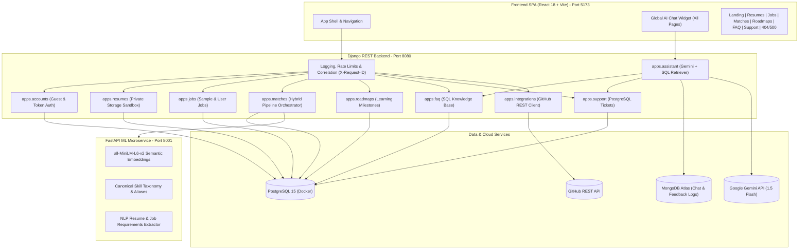

# SkillBridge: AI-Powered Career Guidance and Resume Skill-Matching Platform

SkillBridge is an end-to-end, production-ready career intelligence and resume analysis platform. It enables job seekers—both guests and authenticated users—to upload PDF or DOCX resumes, extract structured technical and soft skills, evaluate alignment against target jobs using an explainable multi-component hybrid matching engine, explore personalized learning roadmaps, and interact with a contextual AI career assistant grounded in a PostgreSQL FAQ knowledge base.

---

## 1. Project Overview & Problem Statement

Modern hiring processes often rely on opaque Applicant Tracking Systems (ATS) that reject candidate resumes without actionable feedback. Simultaneously, candidates lack insight into specific qualification gaps and learning steps required to qualify for their target roles.

**SkillBridge solves this with an open, transparent, and privacy-respecting platform:**
1. **Frictionless Guest Access**: Unauthenticated visitors can immediately explore available jobs, upload and parse their resume, compute skill-match evaluations, review skill gaps, search FAQs, and use the Career Assistant without being forced to create an account.
2. **Explainable Hybrid NLP Match Scoring**: Evaluates candidate resumes against jobs using transparent canonical skill overlap, requirement-weighted coverage (mandatory vs. preferred), and dense semantic similarity embeddings.
3. **Actionable Career Roadmaps**: Converts identified skill gaps into prioritized learning milestones accompanied by verified open-access resources and project challenges.
4. **AI Career Assistant with PostgreSQL FAQ Grounding**: Answers user questions using actual database-backed FAQs and registered error code diagnostics, backed by Google Gemini and persistent MongoDB Atlas conversational logs, with one-click escalation to human support tickets.
5. **Seamless Guest Data Claiming**: Guests can register or log in at any time to permanently save their uploads, analyses, and roadmaps without losing in-progress work.

---

## 2. Main User-Facing Features

- **Guest Resume Ingestion & Parsing**:
  - Direct upload of `.pdf` and `.docx` files without login redirects.
  - Server-side validation of file signatures (magic bytes), file extensions, and file size limits (10MB max).
  - Encrypted, isolated private document storage sandbox outside public web roots.
  - Automatic quota management (max 3 resumes per guest session) and 24-hour expiration cleanup.
- **Job Exploration**:
  - Searchable job catalog with role descriptions, mandatory and preferred requirements, experience levels, and employment types.
  - Pre-seeded with production-grade engineering roles (Full-Stack, ML Engineer, DevOps, Data Engineer).
- **Explainable Resume-to-Job Matching**:
  - **Component A: Requirement-Weighted Fit (45% weight)**: Mandatory requirements evaluated at $1.0\times$, preferred at $0.5\times$, with partial credit ($0.65\times$) for taxonomically related skills.
  - **Component B: Canonical Skill Overlap (35% weight)**: Exact normalized Jaccard overlap between candidate skills and job requirements.
  - **Component C: Dense Semantic Alignment (20% weight)**: Dense embedding cosine similarity computed via `sentence-transformers/all-MiniLM-L6-v2`.
  - Detailed breakdown of matching strengths, missing skills, and recommended next steps.
- **Personalized Learning Roadmaps**:
  - Step-by-step milestones categorized by beginner, intermediate, and advanced levels.
  - Curated open-access resources and practical hands-on project prompts.
- **Interactive Career Assistant on Every Page**:
  - Persistent, non-intrusive chat widget accessible across all pages (Dashboard, Jobs, Resumes, Matches, Roadmaps, FAQ, Support, 404, 500, Login, Register).
  - Contextual responses grounded in PostgreSQL FAQ records.
  - Explanations of platform error codes and instant support ticket creation.
- **Support Ticket Desk**:
  - PostgreSQL-backed ticketing system with automated reference tracking (`SB-YYYY-XXXXX`).
  - Supports both guest and registered user submissions with status tracking.
- **Centralized Help & FAQ**:
  - PostgreSQL-persisted FAQ repository categorized by General, Resumes, Matching, Roadmaps, Account, and Security.
  - Real-time client-side search and category filtering.

---

## 3. Technology Stack

| Layer | Technologies |
|---|---|
| **Frontend** | React 18, TypeScript, Vite, Tailwind CSS, Lucide React, Recharts, React Router DOM v6 |
| **Backend API** | Python 3.11, Django 5.1, Django REST Framework, drf-spectacular (OpenAPI 3.0) |
| **ML Microservice** | FastAPI, Uvicorn, Sentence-Transformers (`all-MiniLM-L6-v2`), PyTorch, scikit-learn |
| **Document Processing** | PyMuPDF (`fitz`), `python-docx`, pure-Python magic byte validator |
| **Primary Relational DB** | PostgreSQL 15 (Docker containerized) |
| **Conversational DB** | MongoDB Atlas (via `pymongo` with resilient fallback) |
| **LLM & Assistant** | Google Gemini (`gemini-1.5-flash`), LangChain Core, PostgreSQL SQL Retriever |
| **Integrations** | GitHub REST API (5.0s bounded timeout with graceful fallback) |
| **Testing** | Pytest, pytest-django, Vitest, React Testing Library |

---

## 4. Architecture Overview



### Guest Workflow Security Architecture
1. **Cryptographic Guest Session Token**: When an unauthenticated visitor enters the platform, the frontend obtains a secure session token via `GET /api/v1/auth/guest-session/`.
2. **Ephemeral Guest Identity**: The backend provisions an isolated, non-login-capable guest account (`guest_<hex>@guest.skillbridge.local`).
3. **Data Isolation**: Guest uploads and analyses enforce foreign-key ownership strictly tied to that guest instance. One guest cannot access or enumerate another guest's data.
4. **Zero-Friction Conversion**: When a guest chooses to register or log in, `claim_guest_data_for_user()` transfers all resumes, match results, and roadmaps to the new authenticated user account.
5. **Session Discard & Cleanup**: Guests can click "Discard Session" at any time to purge their uploaded documents and metadata immediately. An automated management command cleans up sessions inactive for over 24 hours.

---

## 5. Local Setup & Run Instructions

### Prerequisites
- **Python**: 3.11+
- **Node.js**: 18+ (tested on Node 20 and 24)
- **Docker & Docker Compose**: For containerized PostgreSQL

### Step 1: Clone and Prepare Environment
```bash
# Clone the repository (or navigate to workspace)
cd E:\skill_bridge

# Create and activate Python virtual environment
python -m venv .venv
# On Windows:
.venv\Scripts\activate
# On Linux/macOS:
source .venv/bin/activate

# Install backend & ML dependencies
pip install -r backend/requirements.txt
pip install -r ml_service/requirements.txt

# Install frontend dependencies
cd frontend
npm install
cd ..
```

### Step 2: Configure Environment Variables
Copy `.env.example` to `.env` in the repository root:
```bash
cp .env.example .env
```
Fill in the placeholders as described in Section 6 below.

### Step 3: Start PostgreSQL Container
```bash
docker compose -f infrastructure/docker-compose.yml up -d db

# Verify PostgreSQL readiness
docker compose -f infrastructure/docker-compose.yml exec db pg_isready -U skillbridge_user -d skillbridge
```

### Step 4: Run Migrations and Seed Data
```bash
python backend/manage.py migrate
python backend/manage.py seed_skillbridge
```
*This idempotently provisions 12 SQL FAQs, canonical skills, 5 sample jobs, and a default demo user.*

### Step 5: Launch Services
Open three separate terminal windows:

**Terminal 1 — FastAPI ML Microservice (Port 8001):**
```bash
.venv\Scripts\uvicorn ml_service.app.main:app --host 127.0.0.1 --port 8001
```

**Terminal 2 — Django REST Backend (Port 8080):**
```bash
.venv\Scripts\python backend/manage.py runserver 127.0.0.1:8080
```

**Terminal 3 — Vite Frontend (Port 5173):**
```bash
cd frontend
npm run dev
```

Visit the application at: **`http://localhost:5173`**

---

## 6. Environment Variables (Placeholders Only)

All secrets and connection strings are managed via environment variables in `.env` (excluded from git):

| Variable | Description | Example / Placeholder |
|---|---|---|
| `ENVIRONMENT` | Runtime environment mode | `development` |
| `DEBUG` | Django debug flag | `True` |
| `DJANGO_SECRET_KEY` | Secret cryptographic key | `your_django_secret_key_here` |
| `POSTGRES_DB` | PostgreSQL database name | `skillbridge` |
| `POSTGRES_USER` | PostgreSQL user | `skillbridge_user` |
| `POSTGRES_PASSWORD` | PostgreSQL password | `your_postgres_password_here` |
| `POSTGRES_HOST` | PostgreSQL host | `127.0.0.1` |
| `POSTGRES_PORT` | PostgreSQL port | `5432` |
| `MONGODB_URI` | MongoDB Atlas URI for chat logs | `mongodb+srv://<user>:<password>@cluster.mongodb.net/?retryWrites=true&w=majority` |
| `MONGODB_DATABASE` | MongoDB database name | `skillbridge` |
| `GEMINI_API_KEY` | Google Gemini API Key | `your_gemini_api_key_here` |
| `GEMINI_MODEL` | Gemini LLM model name | `gemini-1.5-flash` |
| `GITHUB_API_TOKEN` | Optional GitHub personal access token | `ghp_your_token_here` |
| `ML_SERVICE_URL` | Microservice URL | `http://127.0.0.1:8001` |

---

## 7. Database Setup & Architecture

### PostgreSQL 15 (Relational Data)
Stores all relational business entities:
- `User` and `AuthToken` (Django standard auth & guest sessions).
- `Job` (Role descriptions, mandatory and preferred requirements, experience levels, sample flags).
- `Resume` (Document metadata, private storage file paths, extracted skills, parsing status).
- `MatchResult` (Hybrid match scores, component breakdowns, missing skills, strengths).
- `Roadmap` & `RoadmapMilestone` (Personalized learning roadmaps, resources, and project prompts).
- `FAQ` & `FAQCategory` (Active knowledge base items used for UI display and assistant grounding).
- `SupportTicket` (Support tickets with unique `SB-YYYY-XXXXX` reference codes).

### MongoDB Atlas (Conversational & Telemetry Logs)
Used specifically for unstructured conversational logs:
- `conversations`: Thread identifiers, user/guest bindings, timestamps.
- `messages`: User prompts, assistant answers, grounded FAQ sources, latency.
- `feedback`: User ratings (helpful/unhelpful) and comments.
- **Resilience**: If MongoDB Atlas is unreachable or unconfigured, the application logs a warning and degrades gracefully without failing user requests.

---

## 8. Developer API & Health-Check Endpoints

All core API endpoints are prefixed with `/api/v1/`:

| Endpoint | Method | Auth Required | Purpose |
|---|---|---|---|
| `/api/v1/health/` | GET | No | Liveness probe returning process status and correlation ID |
| `/api/v1/readiness/` | GET | No | Readiness probe testing PostgreSQL ping, ML service ping, and service health |
| `/api/v1/errors/` | GET | No | Error registry documentation and recovery actions |
| `/api/v1/auth/guest-session/` | GET, DELETE | No | Issue or discard cryptographic guest session |
| `/api/v1/auth/register/` | POST | No | User registration (automatically claims active guest data) |
| `/api/v1/auth/login/` | POST | No | User authentication (claims active guest data) |
| `/api/v1/resumes/` | GET, POST | Token / Guest | List or upload resume (`.pdf`, `.docx`) |
| `/api/v1/resumes/<id>/` | GET, DELETE | Token / Guest | Retrieve resume details or delete private document |
| `/api/v1/jobs/` | GET | No | Browse active job listings |
| `/api/v1/matches/evaluate/` | POST | Token / Guest | Run hybrid match evaluation against a target job |
| `/api/v1/matches/<id>/` | GET | Token / Guest | Retrieve match breakdown and recommendations |
| `/api/v1/roadmaps/<id>/` | GET | Token / Guest | View learning roadmap milestones and resources |
| `/api/v1/faq/` | GET | No | Retrieve active FAQs grouped by category |
| `/api/v1/support/tickets/` | POST, GET | No | Create or track support ticket |
| `/api/v1/assistant/chat/` | POST | No | Query AI Assistant (grounded in PostgreSQL FAQs) |
| `/api/v1/integrations/github/` | GET | Token / Guest | Fetch developer profile insights |

---

## 9. Error Code Reference

SkillBridge provides structured, safe error responses without leaking internal paths or database exceptions:

| Code | HTTP Status | Description | User Recovery Action |
|---|---|---|---|
| `400` | 400 | Bad Request | Verify request parameters and form fields |
| `401` | 401 | Unauthorized | Sign in or refresh authentication token |
| `403` | 403 | Forbidden | Access restricted to resource owner |
| `404` | 404 | Not Found | Check the URL or return to the Dashboard |
| `429` | 429 | Too Many Requests | Rate limit reached; wait 60 seconds before retrying |
| `500` | 500 | Internal Server Error | Server encountered an unexpected state; retry shortly or submit a ticket |
| `503` | 503 | Service Unavailable | Downstream dependency unavailable; retry shortly |
| `SB-1001` | 422 | Resume Processing Failed | Ensure the uploaded document is not password-protected or image-only |

The frontend features dedicated custom **404 Not Found** and **500 Server Error** pages featuring working "Return to Dashboard" navigation and an embedded "Ask Career Assistant" trigger.

---

## 10. Third-Party API Integration & Fallback Behavior

### GitHub REST API Integration (`apps/integrations/github.py`)
SkillBridge integrates with the public GitHub REST API to correlate a candidate's public repositories and top programming languages with target job requirements.

- **Bounded Timeout**: Configured with a strict 5.0-second timeout to prevent connection starvation.
- **Fallback on Timeout**: Returns a graceful fallback response `{ "connected": false, "reason": "timeout", "languages": [] }` without blocking resume evaluation.
- **Fallback on Rate Limit (HTTP 403)**: Detects GitHub API rate limits and serves a cached or empty profile summary with an informative banner.
- **Fallback on User Not Found (HTTP 404)**: Informs the candidate that the provided GitHub username does not exist without failing the overall evaluation.
- **Logging**: Safe request logging that records request status without leaking authentication tokens or personal identifiers.

---

## 11. Automated Test Verification & Actual Results

### Test Execution Commands
```bash
# 1. Full Backend Django Test Suite (33 tests)
.venv\Scripts\pytest backend/tests/ -v

# 2. FastAPI ML Microservice Test Suite (9 tests)
.venv\Scripts\pytest ml_service/tests/ -v

# 3. Frontend Production Build & Type-Check
cd frontend && npm run build
```

### Actual Measured Test Results
- **Backend Test Suite**: **33 passed in 56.45s** (100% pass rate).
  - Includes `test_guest_workflow.py` (9 tests covering guest session issuance, PDF/DOCX uploads, isolated access, quota limits, registration conversion, and session discard).
  - Includes `test_phase2_upgrades.py` (covering FAQ grounded assistant, support ticket creation, error registry, GitHub timeout/fallback, and readiness probe).
  - Includes existing model, ownership, resume storage, and matching pipeline tests.
- **FastAPI ML Microservice**: **9 passed in 21.30s** (100% pass rate).
  - Tests canonical perfect match, partial match, related skill credit, health endpoint, token validation, and requirement extraction.
- **Frontend Build**: Built in **10.52s** with **zero errors**.
- **Browser Automation Verification**:
  - Landing page "Upload Resume" button navigates directly to `/resumes` with zero login redirects.
  - Custom 404 page verified on invalid URLs with "Ask Assistant" action.
  - Custom 500 page verified at `/500`.
  - Mobile responsiveness verified at 375x812 with zero horizontal overflow.

---

## 12. Production Deployment & Live Links

### Architecture & Service Breakdown (Render Blueprint `render.yaml`)

SkillBridge is configured for automated deployment on [Render](https://render.com) using Infrastructure-as-Code via `render.yaml`:

| Service | Type | Environment | Internal Name | Public Production URL |
|---|---|---|---|---|
| **Frontend** | Static Site | Node (Vite build) | `skillbridge-frontend` | `https://skillbridge-frontend.onrender.com` |
| **Backend** | Web Service | Python 3.11 (Gunicorn + Whitenoise) | `skillbridge-api` | `https://skillbridge-api.onrender.com` |
| **ML Microservice** | Web Service | Python 3.11 (Uvicorn + FastAPI) | `skillbridge-ml` | `https://skillbridge-ml.onrender.com` |
| **Database** | Managed Database | PostgreSQL 15 | `skillbridge-db` | Internal connection via `DATABASE_URL` |

### Private Resume Storage in Production
- Resumes are stored strictly under `private_storage/users/<user_id>/` outside the public static and media roots.
- On Render's standard web service, storage is local to the container instance.
- **Production Recommendation**: For multi-instance horizontal scaling and persistence across major container redeployments, connect a Render Persistent Disk or S3-compatible object storage (AWS S3 / Cloudflare R2).

### Deployment Status
- **GitHub Target Repository**: [`https://github.com/jaishanthlenin-123/skillbridge`](https://github.com/jaishanthlenin-123/skillbridge)
- **Local Application (Fully Verified & Operational)**:
  - Frontend: `http://localhost:5173/`
  - Backend API: `http://127.0.0.1:8080/api/v1/`
  - ML Microservice: `http://127.0.0.1:8001/`
- **Render Cloud HTTPS Deployment**: *Ready for automated provisioning via `render.yaml` Blueprint once code is pushed to GitHub.*

### One-Click Render Deployment Instructions
1. Create empty repository `skillbridge` on GitHub: [https://github.com/new](https://github.com/new).
2. Push local commits: `git push -u origin master`.
3. Go to [Render Dashboard](https://dashboard.render.com) -> Click **New +** -> **Blueprint**.
4. Select repository `jaishanthlenin-123/skillbridge`.
5. Enter manual secrets (`GEMINI_API_KEY` and `MONGODB_URI`).
6. Click **Apply**. Render will automatically provision PostgreSQL, launch the ML service, run Django migrations & seeds, and build the Vite frontend with automatic HTTPS.

---

## 13. Proposed Future Improvements

1. **Optical Character Recognition (OCR) for Scanned Documents**: Integrate Tesseract OCR or Google Document AI to parse scanned image-only PDFs that currently trigger error `SB-1001`.
2. **AI-Powered Resume Tailoring Suggestions**: Extend the Career Assistant to provide line-by-line bullet point rewrite recommendations customized for specific job postings.
3. **Continuous Domain-Specific Taxonomy Expansion**: Implement automated skill graph enrichment from industry hiring trends to identify emerging frameworks and methodologies.
